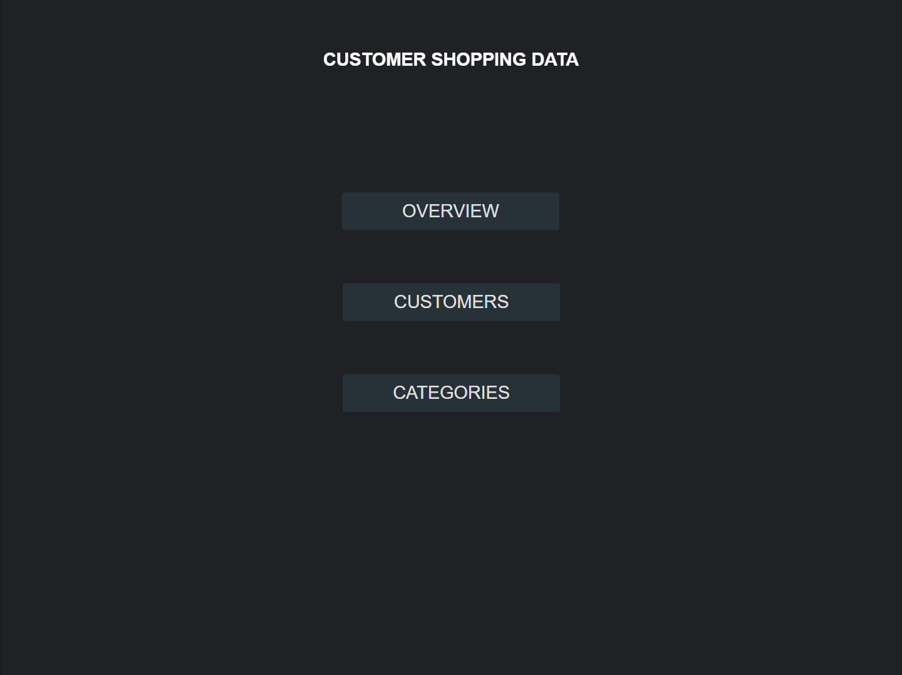
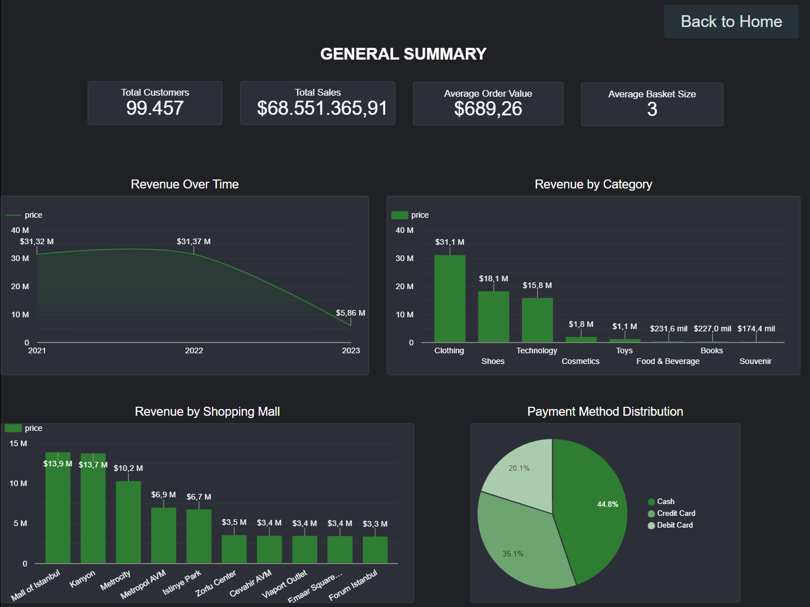
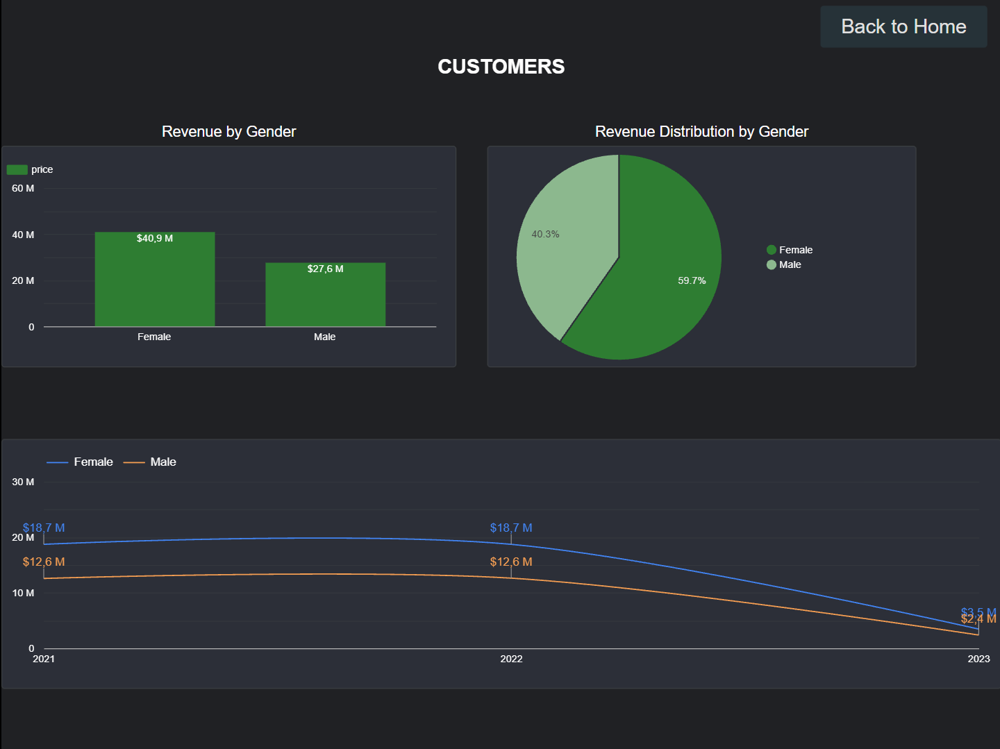
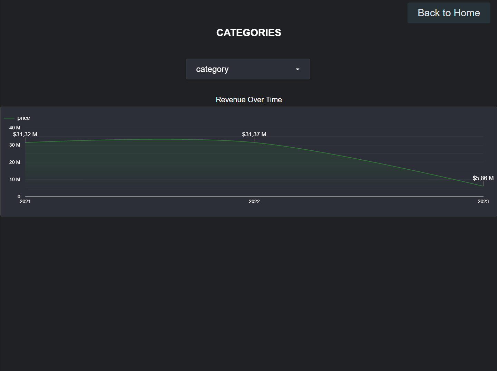

# customer-shopping-data-looker-dashboard
Interactive BI dashboard developed in Looker Studio for executive performance tracking

# 📊 Executive BI Dashboard – Multi-Page Retail Performance Analysis

## 📌 Project Overview / Descripción del Proyecto
**EN:** Multi-page interactive Business Intelligence dashboard developed in Looker Studio. Designed to analyze retail performance through executive KPIs, customer gender breakdown, category revenue trends (2021–2023), and payment method distribution.  
**ES:** Dashboard interactivo multi-página de Business Intelligence desarrollado en Looker Studio. Diseñado para analizar el rendimiento de ventas minoristas a través de KPIs ejecutivos, desglose de clientes por género, tendencias de ingresos por categoría (2021–2023) y distribución de métodos de pago.

---

## 🔗 Live Interactive Dashboard
👉 **[Click here to access the Live Dashboard on Looker Studio](https://datastudio.google.com/reporting/be5ca473-9783-46f1-862d-b936c5c6f45e)**

---

## 📸 Dashboard Pages & Architecture

### 1. Index Page
*Central navigation hub providing structured access to all analytical modules.*

---

### 2. General Summary Page
*High-level executive overview tracking overall sales volume, customer volume, and regional distribution.*

* **Key Metrics & KPIs:** Total Customers, Total Sales, Average Order Value (AOV), Average Basket Size.
* **Core Visualizations:** Revenue over Time, Revenue by Category, Revenue by Shopping Mall, and Payment Method Distribution.

---

### 3. Customers Analysis Page
*Customer revenue breakdowns and gender-based purchasing pattern analysis.*

* **Key Metrics & Insights:** Revenue by Gender and Revenue Distribution by Gender.
* **Historical Trend Tracking:** Revenue by Gender multi-year trend analysis covering 2021 to 2023.

---

### 4. Categories Performance Page
*Deep dive into product catalog performance and category dynamics.*

* **Core Analytics:** Category-filtered Revenue over Time to evaluate long-term demand and seasonality across product lines.

---

## 🛠️ Tools & Technologies Used
* **Data Visualization & BI:** Looker Studio
* **Data Source & Prep:** [Dataset (CSV)](customer_shopping_data_rgcsv) / Google Sheets
* **Key Features:** Cross-filtering, multi-year time series analysis (2021–2023), dynamic category slicers, multi-page layout architecture.

---

## 📬 Contact
* **GitHub:** [Rafael Goatache](https://github.com/RafaGoatache)
* **LinkedIn:** [Rafael Goatache](https://www.linkedin.com/in/rafa-goatache)
